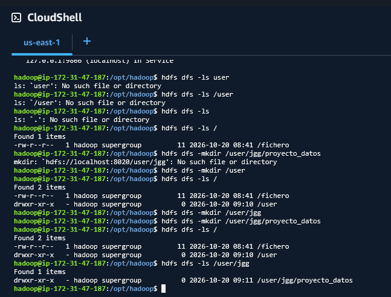
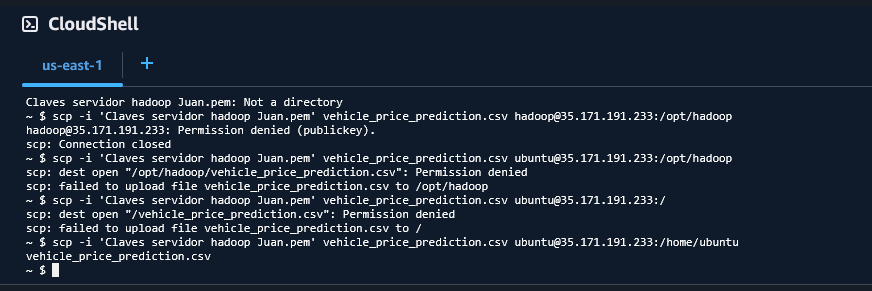
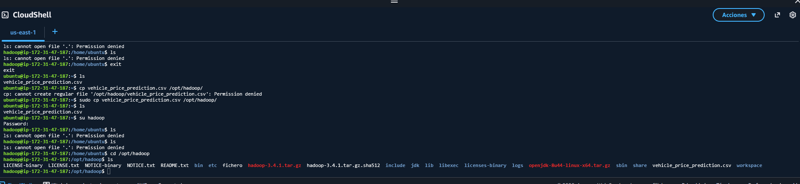
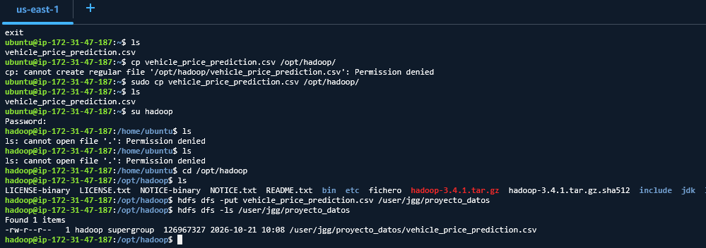
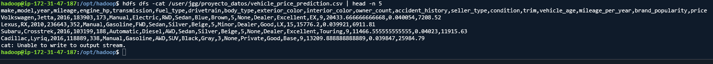
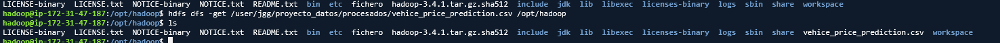
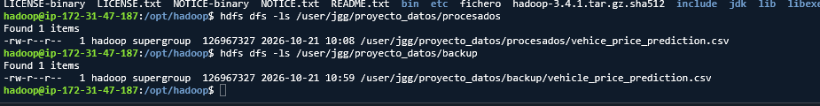
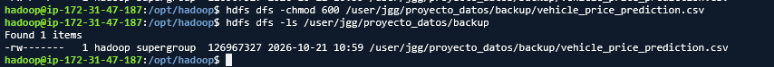
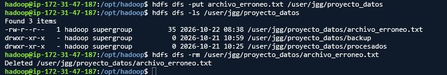

# BIG DATA APLICADO - JUAN GUTIERREZ GUTIERREZ
# PR0202: Uso del cliente HDFS

## 1 - Preparación del entorno

## 2 - Carga de datasets

## 3 - Exploración de datos

## 4 - Organización del proyecto

## 5 - Colaboración en el equipo

## 6 - Recuperación de datos

## 7 - Control de accesos

## 8 - Mantenimiento

[VOLVER](../index.md)